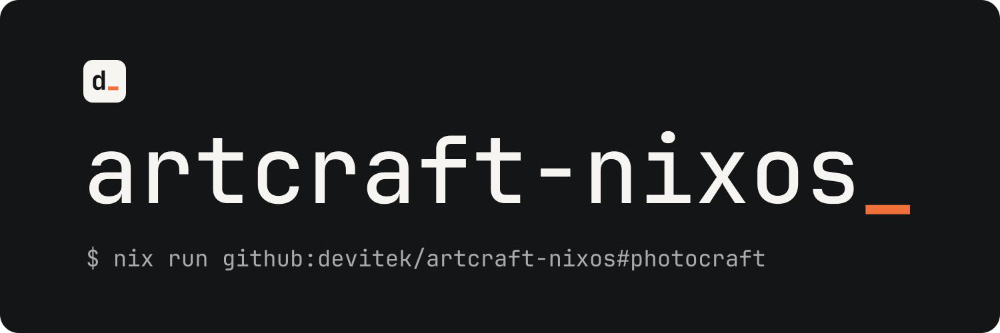

<p align="center">
  
</p>

<p align="center">The ArtCraft creative suite for NixOS, kept in sync with upstream releases.</p>

<p align="center">
  <a href="https://github.com/Devitek/artcraft-nixos/releases/latest"></a>
  <a href="https://github.com/Devitek/artcraft-nixos/actions/workflows/ci.yml"></a>
  <a href="https://github.com/Devitek/artcraft-nixos/actions/workflows/update.yml"></a>
  <a href="LICENSE"></a>
</p>

<p align="center">
  <a href="#installation">Installation</a> ·
  <a href="#usage">Usage</a> ·
  <a href="#documentation">Documentation</a> ·
  <a href="CHANGELOG.md">Changelog</a> ·
  <a href="CONTRIBUTING.md">Contributing</a>
</p>

[ArtCraft](https://github.com/storytold) is a suite of creative apps by storytold. This repository repackages their official pre-built Linux releases for NixOS, with desktop entries and declarative install. New upstream releases are picked up, built, smoke-tested and merged automatically.

> [!NOTE]
> Community project, not affiliated with or endorsed by storytold / Learning Machines LLC. App bugs belong upstream; packaging bugs belong [here](https://github.com/Devitek/artcraft-nixos/issues).

## Installation

Try an app without installing anything:

```sh
nix run github:devitek/artcraft-nixos#photocraft
```

Or add the flake to your inputs:

```nix
{
  inputs.artcraft.url = "github:devitek/artcraft-nixos";
  inputs.artcraft.inputs.nixpkgs.follows = "nixpkgs"; # optional
}
```

Supports `x86_64-linux` and `aarch64-linux`. The apps render on the GPU, so enable `hardware.graphics.enable = true;` on NixOS.

## Applications

| Package | What it does | Version | Upstream |
| --- | --- | --- | --- |
| `photocraft` | Raster image editing |  | [storytold/photocraft](https://github.com/storytold/photocraft) |
| `vectorcraft` | Vector graphics |  | [storytold/vectorcraft](https://github.com/storytold/vectorcraft) |
| `filmcraft` | Video editing |  | [storytold/filmcraft](https://github.com/storytold/filmcraft) |
| `lightcraft` | Lighting / photo processing |  | [storytold/lightcraft](https://github.com/storytold/lightcraft) |
| `pdfcraft` | PDF tooling |  | [storytold/pdfcraft](https://github.com/storytold/pdfcraft) |
| `effectcraft` | Visual effects |  | [storytold/effectcraft](https://github.com/storytold/effectcraft) |
| `designcraft` | Design / layout |  | [storytold/designcraft](https://github.com/storytold/designcraft) |
| `gridcraft` | Spreadsheets / grids |  | [storytold/gridcraft](https://github.com/storytold/gridcraft) |
| `wordcraft` | Word processing |  | [storytold/wordcraft](https://github.com/storytold/wordcraft) |
| `deckcraft` | Presentations |  | [storytold/deckcraft](https://github.com/storytold/deckcraft) |
| `cadcraft` | CAD |  | [storytold/cadcraft](https://github.com/storytold/cadcraft) |
| `soundcraft` | Audio |  | [storytold/soundcraft](https://github.com/storytold/soundcraft) |
| `figcraft` | UI design / prototyping |  | [storytold/figcraft](https://github.com/storytold/figcraft) |
| `craft-anything` | Reverse engineering |  | [storytold/craft-anything](https://github.com/storytold/craft-anything) |

Each app ships with its `*-cli` companion. The craft-launcher is not packaged: on NixOS, this flake is the installer ([ADR-0004](docs/adr/0004-exclude-launcher.md)).

## Usage

**NixOS**

```nix
{
  imports = [ artcraft.nixosModules.default ];
  programs.artcraft = {
    enable = true;
    apps = [ "photocraft" "vectorcraft" "pdfcraft" ]; # default: all apps
  };
}
```

**Home Manager**

```nix
{
  imports = [ artcraft.homeManagerModules.default ];
  programs.artcraft = {
    enable = true;
    apps = [ "photocraft" "soundcraft" ];
  };
}
```

**Overlay**

```nix
nixpkgs.overlays = [ artcraft.overlays.default ];
# then: pkgs.artcraft.photocraft
```

## How updates work

[nvfetcher](https://github.com/berberman/nvfetcher) tracks upstream releases. When a new one lands, the update workflow refreshes the versions and hashes, runs `nix flake check` (builds, smoke tests, module evaluation) and merges the change. [release-please](https://github.com/googleapis/release-please) then cuts a SemVer release of this repository. Pin a tag if you prefer to update on your own schedule.

<details>
<summary><strong>Troubleshooting</strong></summary>

**`HTTP error 403` when fetching the flake.** Fetch over git instead of the GitHub API:

```sh
nix run 'git+https://github.com/devitek/artcraft-nixos#photocraft'
```

</details>

## Documentation

- [Functional overview](docs/functional.md)
- [Technical architecture](docs/technical.md)
- [Architecture Decision Records](docs/adr/)

## Contributing

Contributions are welcome. Please read [CONTRIBUTING.md](CONTRIBUTING.md) first: one issue per change, Conventional Commits, green CI.

## License

The packaging code is released under the [MIT License](LICENSE). The apps remain under their upstream licenses (`MIT OR Apache-2.0`).

---

<p align="center">
  <a href="https://github.com/Devitek">
    <picture>
      <source media="(prefers-color-scheme: dark)" srcset=".github/assets/devitek-wordmark-blanc.svg">
      
    </picture>
  </a>
  <br>
  <sub>Built and maintained by <a href="https://github.com/Devitek">Devitek</a></sub>
</p>
